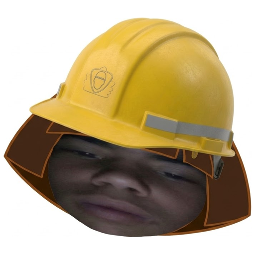
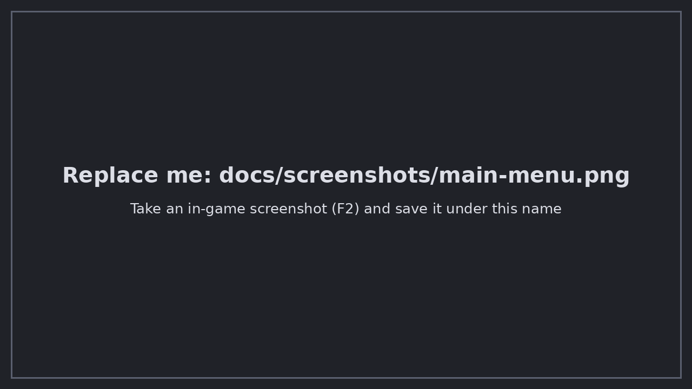
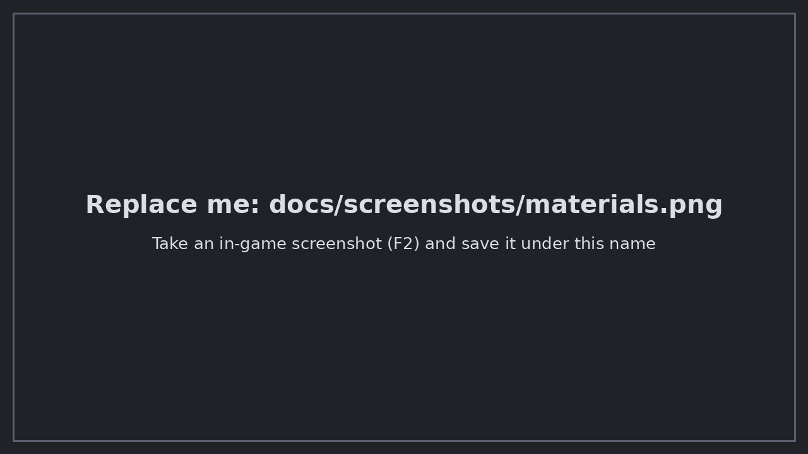
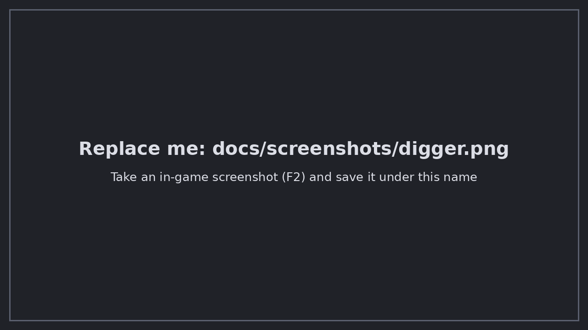

<p align="center">
  
</p>

<h1 align="center">Bob the Builder</h1>

<p align="center">
  <b>Load a schematic, see it as a hologram, and let Bob build it for you.</b><br>
  A client-side Fabric mod for Minecraft Java 1.21.11
</p>

<p align="center">
  
  
  
  
</p>

---

## Overview

**Bob the Builder** is a Litematica-style building assistant with a built-in robot worker. Drop a `.schem` or `.litematic` file into a folder, place a ghost hologram of the building in your world, check the materials, and let Bob construct it layer by layer, block by block, with the exact block states.

Bob can also dig out whole areas, fetch materials from chests, avoid danger, fly with an elytra and pick up exactly where he stopped after you restart the game.

## Features

- **Schematic support** - loads `.schem` and `.litematic` files.
- **Hologram preview** - semi-transparent ghost blocks plus an outline (blue = missing, red = wrong). Ghost / Wireframe / Both modes.
- **Material list** - see every block needed, count the chests required, and swap any material for another block with one click.
- **Three ways to build** - your own character, a separate **Helper bot**, or by hand with the hologram as a guide.
- **Smart pathfinding** - walks, jumps, drops, avoids lava, fire, cactus and water; builds temporary bridges and pillars for floating structures and removes them afterwards.
- **Digger** - select two corners and Bob digs the whole area layer by layer, collecting drops into chests if you want.
- **Survival-aware** - fetches materials from chests, stores surplus in loot chests, picks the best tool, eats, fights nearby monsters and handles low health.
- **Elytra flight** - flies to far or high build sites when an elytra (and fireworks) are available.
- **Pause / resume** - progress is saved to disk, so you can leave the world, restart the game and continue.
- **Clean in-game menus** - everything is controlled from scrollable menus inside Minecraft. No external program needed.

## Screenshots

| Main menu | Hologram |
|---|---|
|  |  |

| Materials | Build steps |
|---|---|
|  |  |

| Digger | Helper bot |
|---|---|
|  |  |

## Requirements

| Requirement | Version |
|---|---|
| Minecraft Java Edition | 1.21.11 |
| [Fabric Loader](https://fabricmc.net/use/installer/) | 0.18.1 or newer |
| [Fabric API](https://modrinth.com/mod/fabric-api) | 0.141.1+1.21.11 |
| Java | 21 |

## Installation

1. Install **Fabric Loader** for Minecraft 1.21.11 using the official installer.
2. Download **Fabric API** and put it in your `mods` folder.
3. Download the latest `bobsc-*.jar` from the [Releases](../../releases) page and put it in the same `mods` folder.
4. Start the game with the Fabric profile.
5. On first launch the mod creates the folder `.minecraft/bobsc/`. Put your `.schem` / `.litematic` files there.

> The mod runs on the client only. It can be used in singleplayer and on servers.

## How to use it in game

### Quick start

1. Press **B** and choose a building from the list.
2. Press **N** to open the main menu and go to **Build a building**.
3. Follow the steps in order (green tick = done, yellow arrow = next step):
   1. Choose a building
   2. Place the building (move the hologram to where you want it)
   3. See the materials
   4. Put the chests
   5. Check the chests
   6. Check my inventory
   7. **START building**
4. Pick **who builds**: *My character*, *Helper bot* or *I build by hand*.
5. Watch the progress bar at the top of the screen. Press **J** to pause and continue.

### Keybinds

| Key | Action |
|---|---|
| `B` | Pick a building (schematic list) |
| `N` | Open the Bob the Builder main menu |
| `G` | Dig an area (Digger) |
| `J` | Pause / continue the bot |
| `V` | Helper bot: start building |

All keys can be changed in **Options -> Controls -> Key Binds -> Bob the Builder**.

### Helper bot chat commands

| Command | What it does |
|---|---|
| `!come` | Bob comes to you |
| `!build` | Bob starts building |
| `!stop` | Bob stops |
| `!leave` | Bob leaves the game |

### Digging an area

1. Press **G**.
2. Look at a block and click **Set A**, then look at another block and click **Set B**.
3. Choose what happens to the items (collect in chests, or leave them).
4. Click **Go**.

## Building from source

Requirements: JDK 21 and the Fabric Loom plugin (already configured in `build.gradle`).

```bash
git clone https://github.com/<your-username>/bobsc-mod.git
cd bobsc-mod
gradle wrapper        # or copy the gradle/wrapper folder from the official Fabric example mod
./gradlew build
```

The jar is created in `build/libs/`. A GitHub Actions workflow (`.github/workflows/build.yml`) builds it on every push.

## Project layout

```
src/main/java/com/bobsc/        mod source (bot, pathfinding, hologram, digger, ...)
src/main/java/com/bobsc/screen/ in-game menus
src/main/resources/             fabric.mod.json, language file, textures, icon
docs/                           logo and screenshots
CHANGELOG.md                    version history
```

## Contributing

Issues and pull requests are welcome. Please open an issue first for larger changes.

## Author

Developed by **mossa natite**.

## License

Released under the [MIT License](LICENSE) - (c) 2026 mossa natite.
